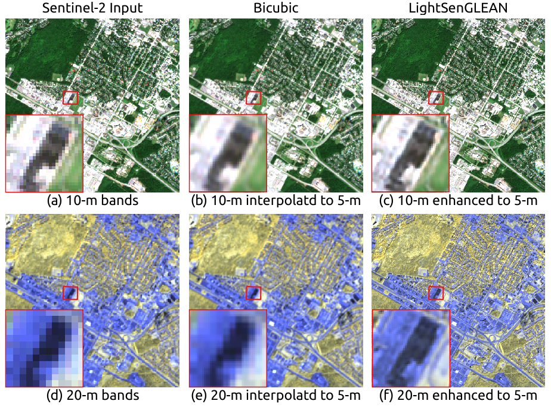

# SenGLEAN - Official PyTorch Implementation



**An End-to-End Deep Learning Approach for Super-Resolution of Sentinel-2 Multi-Resolution Multispectral Images**<br>
Ayush Gupta, Rakesh Mishra, Yun Zhang<br>

Paper: https://doi.org/10.1109/TGRS.2024.3374575<br>

### Environment Requirements

```bash
module load python/3.8.10
module load gcc gdal opencv cuda
pip install -r requirements_cc.txt
```

Increase spatial resolution of multispectral images using AI (ML/DL)

**All Bands SR model**

* [SenGLEAN](./SenGLEAN/)
* [LightSenGLEAN](./LightSenGLEAN/)

For evaluation the model on a new dataset first perform target adaptation using each of the models as instructed in their respective ***./Testing*** directory and save the checkpoints.

Then you can perform the inference using the [Inference Notebook](./Inference.ipynb)

> **_NOTE_:** During inference the bands of sentinel input must be [B2, B3, B4, B8] @ 10m  + [ B5, B6, B7, B8a ] (interpolated to 10m)


## Citation

```
@ARTICLE{Gupta2024senglean,
  author={Gupta, Ayush and Mishra, Rakesh and Zhang, Yun},
  journal={IEEE Transactions on Geoscience and Remote Sensing}, 
  title={SenGLEAN: An End-to-End Deep Learning Approach for Super-Resolution of Sentinel-2 Multi-Resolution Multispectral Images}, 
  year={2024},
  doi={10.1109/TGRS.2024.3374575}}
```
